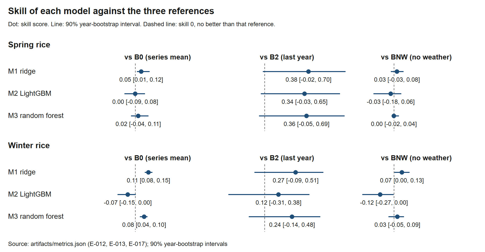

# Miaudow

Miaudow is a phone-first web app, in Vietnamese and English, for farmers and extension officers on drought-prone,
low-productivity rice land in Nghe An, Vietnam. It puts six one-year crop plans side by side, two descriptions of
current practice (rice) and four alternatives from a published local field trial, in past years that the farmer picks.
Each past year is labelled with Vietnam's official hazard rules computed from NASA data.

- Live app: https://miaudow.solareclipse.observer
- Built by Team Miau for the NASA Space Apps Challenge 2026, challenge "Field Shift: Adapting Farms with NASA Data".

## 1. What Miaudow does

The home page starts with a short "What does this app do?" box and the four steps; the material for extension officers
comes below, under its own heading. A farmer answers three questions by tapping: what the field is like, which past
years the family remembers (or "pick the hardest years for me"), and what matters most (income, stability, water or
land care). Miaudow then shows six crop plans for one year, one card each, named "Current practice" or "Trial way of
farming n" with its crops. Every card has the same rows: the trial's money in million VND per hectare, irrigation
water, how often official drought, heat and heavy-rain conditions hit each crop in the chosen years, NASA soil wetness,
care for the land, the points to weigh, and the months when the field is bare. The farmer's priority is highlighted on
every card, but the cards are never reordered or ranked. Every number opens its source sheet, which also holds the
source's notes and exact values. Every card lists questions about that plan to take to the extension officer, and
ends with a reminder to check with local farmers or experts before changing anything.

## 2. Features

**Farmer flow, 4 steps, no typing** (`#/nong-dan`, English `#/farmer`):

1. Field: picture cards in the words farmers use ("high and dry", "end of the canal", "short of water", or "not sure,
   ask the extension officer"). A field with reliable water gets no comparison: no plan was tested on such land. Above
   them, the province line reads Nghe An and cannot be changed; other provinces are not available yet.
2. Past years: pick up to 10 years from 1995-2024 that the family remembers, or tap "Don't remember? Pick the hardest
   years for me": for each official hazard, the most recent year in which it covered the most farmland (2013, 2020,
   2022 and 2024 with the data in the app); the picked years stay editable. Each year shows the share of Nghe An
   farmland that met each official hazard rule of Decision 18/2021/QĐ-TTg (heavy rain, heat, drought, damaging cold).
   Always labelled as a past year, never a forecast, with its limits ("grid values smooth out extremes"). A "?" button
   beside each hazard opens the rule's own text and its sources.
3. Priority: one tap (income, stability, water or land care).
4. Plans: one card per plan, named "Current practice" or "Trial way of farming n" (Vietnamese "Cách làm hiện nay",
   "Cách trồng thử n") above its crop list. The card face shows the money total, the water line, the farmer's
   priority and the four warnings; every row folds behind a heading button, and the strip at the top marks the card
   in view. All cards have the same rows:
   - Money: net profit and total cost per crop as reported in the trial (prices of 2020-21), labelled "Profit in the
     trial, not on your own field", shown in million VND/ha (Vietnamese "triệu đồng/ha"); the source sheet keeps the
     paper's exact value in thousand VND/ha. The whole-year total is our addition, labelled as such. The local-practice
     card of the second study shows that paper's own season values (spring 5.36, summer-autumn 1.16 million VND/ha,
     autumn-winter fallow), never summed and never compared with the first study's cards.
   - Water: seasonal irrigation from the national standard TCVN 8641:2011 in m³/ha, shown as a range over the
     standard's regional rows (the standard does not say which region Nghe An belongs to); FAO's rough estimate of
     crop water need where listed.
   - Bad weather: past-year hazard shares per crop, if sown on the trial's 2020-21 dates.
   - NASA soil wetness: root-zone wetness per crop and year next to its 1991-2020 average, labelled "NASA model value,
     not a field measurement" (MERRA-2 is named in the source sheet).
   - Care for the land: three separate checks, no score: different crops in the year, days with a living crop, legume
     grown (with its caveat).
   - Weigh this: one plain line per quoted risk (costs, local buyers, purchase contracts for fodder maize, Decree
     112/2024's rules on changing crops on rice land), each with its source in a few words; the full quote opens in
     the source sheet. Then the officer page's questions for this plan.
   - Province rice against normal (rice plans): the official provincial history for the picked years.
   - Priority line (trial plans): the same measure for this plan and for current practice from the same trial, side by
     side. It never says better, best or recommended.
   - Tapping any number opens its source sheet: a trust label made of facts about that source only, and the source's
     longer notes (table numbers, definitions, the standard's notes).

**Your price and costs** (optional, on the trial plan cards): the farmer can type a sale price per kg and their own
costs for each crop in million VND/ha, the unit every money number shows (one decimal; stored as whole thousand
VND/ha). The phone works out revenue (the study yield times the typed price) and, once a cost is typed, revenue minus
cost, shown in million VND/ha. Both are labelled as the farmer's own numbers, and the trial's money row stays as it was.

**Phone checks**: browser acceptance tests (`frontend/e2e/acceptance.spec.ts`) check 22 pages at 200% zoom of a
360 x 740 phone (no text cut off, every control reachable), 44 x 44 px tap targets on the plans page, and no sliders.

**Other pages** (Vietnamese path, English path):

| Page           | Path                                               | What it shows                                                                                                                                                                                                       |
| -------------- | -------------------------------------------------- | ------------------------------------------------------------------------------------------------------------------------------------------------------------------------------------------------------------------- |
| Home           | `#/`, `#/home`                                     | A "What does this app do?" box and the four steps with one start button; below, for extension officers, the trial, 30 years of drought, the AI cores and the model test.                                            |
| Officer        | `#/can-bo`, `#/officer`                            | The evidence behind every card row, with the points where evidence is thin.                                                                                                                                         |
| Science        | `#/khoa-hoc`, `#/science`                          | Nghe An over 30 seasons: the NASA POWER grid, rice yield against normal, two rain sources (NASA POWER and CHIRPS), MODIS NDVI around the trial site.                                                                |
| Method         | `#/phuong-phap`, `#/method`                        | Model test results and pass or fail checks (from `artifacts/`), which data exist for each crop, the terms explained, datasets not used, limitations.                                                                |
| Observatory    | `#/dai-quan-sat`, `#/observatory`                  | From space down to Nghe An: a 3D globe with NASA GIBS layers that labels Hoang Sa, Truong Sa and Phu Quoc (Wikidata points), six Sentinel-2 greenness images of the former Do Luong district, NASA Eyes in a frame. |
| Evidence       | `#/bang-chung`, `#/evidence`                       | Every conclusion with its source, where the sources disagree, and the state of each dataset.                                                                                                                        |
| Assistant      | `#/tro-ly`, `#/assistant`                          | The copilot (see below).                                                                                                                                                                                            |
| Sign-in, saved | `#/dang-nhap`, `#/da-luu` (`#/sign-in`, `#/saved`) | Optional Google sign-in to save up to 20 sets of answers and reopen them on another phone.                                                                                                                          |
| Privacy        | `/quyen-rieng-tu` (`/privacy` redirects there)     | The privacy notice (see section 5), with no script and no third-party resource.                                                                                                                                     |

**AI features** (on in the deployed app; each needs its server switch, `FIELDSHIFT_EXPLAIN` or `FIELDSHIFT_COPILOT`, and
the API key, so a local copy without them runs with both off).

- "Explain simply" on the cards rewords a card's "why" text in simpler words with the Claude API. The browser sends
  only a plan id and which part; the server takes the text from its own answer. A reply whose numbers differ from the
  source text is refused. The result is labelled "Reworded by AI (Claude) to be simpler; it can be wrong."
- The copilot is extractive: the model returns only the ids of passages and data results that answer the question; the
  server checks the ids and shows those passages word for word with their sources. No model-written sentence reaches
  the farmer. Without the key it answers from fixed sentences with no model.

## 3. NASA data and how it is used

Full citations, links and terms: `rules/sources.yaml` and the app's evidence page.

| NASA data                                                                                                                                                                          | Used for                                                                                                                                                                 | Link                                                                                                                               |
| ---------------------------------------------------------------------------------------------------------------------------------------------------------------------------------- | ------------------------------------------------------------------------------------------------------------------------------------------------------------------------ | ---------------------------------------------------------------------------------------------------------------------------------- |
| NASA POWER Daily API v2.10.3, agroclimatology community (MERRA-2 based): rain, temperature, humidity, wind, radiation, root-zone soil wetness, 1990-2024, every cell with farmland | Official hazard shares per past year and crop; the weather features of the rice model; soil wetness on the cards; the science page                                       | [power.larc.nasa.gov](https://power.larc.nasa.gov/)                                                                                |
| MODIS MCD12C1 v061 land cover, 0.05°, 2001-2015                                                                                                                                    | The fixed farmland mask: each POWER cell weighted by its farmland                                                                                                        | [NASA CMR record](https://cmr.earthdata.nasa.gov/search/concepts/C2484078896-LPCLOUD.html)                                         |
| MODIS MOD13Q1 v061 NDVI, 16-day, 250 m, via the ORNL DAAC subset tool                                                                                                              | Greenness chart around the trial site on the science page; never a model input (an in-season crop signal would leak the outcome)                                         | [NASA CMR record](https://cmr.earthdata.nasa.gov/search/concepts/C1748066515-LPCLOUD.html); [subset tool](https://modis.ornl.gov/) |
| NASA GIBS map tiles (Blue Marble, MODIS NDVI, IMERG rain rate, SMAP root-zone soil moisture)                                                                                       | Picture layers on the observatory globe, labelled as visual only; no number comes from them                                                                              | [GIBS documentation](https://nasa-gibs.github.io/gibs-api-docs/)                                                                   |
| NASA Eyes (eyes.nasa.gov)                                                                                                                                                          | Framed on the observatory page, visual context only                                                                                                                      | [eyes.nasa.gov](https://eyes.nasa.gov/)                                                                                            |
| NASA CMR collection metadata                                                                                                                                                       | Start dates and titles in the "datasets considered and not used" list (ECOSTRESS, Landsat, VIIRS, HLS Sentinel-2, GLDAS, GRACE)                                          | [CMR search](https://cmr.earthdata.nasa.gov/search/)                                                                               |
| GPM IMERG Final monthly V07                                                                                                                                                        | Satellite rain check on the method page: correlation and mean monthly rain against POWER, 2001-2024 (288 monthly files, Nghe An cells). Neither series is ground truth.  | [NASA CMR record](https://cmr.earthdata.nasa.gov/search/concepts/C2723754851-GES_DISC.html)                                        |
| NASA SRTM Global 3 arc second V003 (SRTMGL3), ground height, about 90 m, 9 tiles of 1° over the Nghe An map frame | Optional terrain layer under the flat data-room map: a grey hill-shaded picture (Horn 1981, sun at 315° and 45°), off by default, labelled "height only"; no number comes from it | [NASA SRTM record](https://doi.org/10.5067/MEaSUREs/SRTM/SRTMGL3.003) |

**Other data**

| Data                                                                                                 | Used for                                                                                                                                                       | Link                                                                                                                                                                                            |
| ---------------------------------------------------------------------------------------------------- | -------------------------------------------------------------------------------------------------------------------------------------------------------------- | ----------------------------------------------------------------------------------------------------------------------------------------------------------------------------------------------- |
| National Statistics Office of Viet Nam (Cục Thống kê), PX-Web tables, province rice yields 1995-2024 | Model target and the rice history on the cards. Credit: "Source: website of the National Statistics Office (www.gso.gov.vn)". Raw files are not redistributed. | [PX-Web](https://pxweb.nso.gov.vn/pxweb/en/)                                                                                                                                                    |
| geoBoundaries (province and district outlines)                                                       | Province outline for the farmland weights and maps                                                                                                             | [geoboundaries.org](https://www.geoboundaries.org/)                                                                                                                                             |
| Decision 18/2021/QĐ-TTg (Prime Minister of Vietnam)                                                  | The official hazard rules and their definitions                                                                                                                | [text (.doc, Vietnamese)](https://vupc.mae.gov.vn/Data/files/18_2021_QD-TTg.doc)                                                                                                                |
| TCVN 8641:2011 (national irrigation standard)                                                        | Irrigation amounts on the cards (values quoted with source; text not redistributed)                                                                            | [text (Vietnamese)](https://caselaw.vn/van-ban-phap-luat/252217-tieu-chuan-quoc-gia-tcvn-8641-2011-ve-cong-trinh-thuy-loi-ky-thuat-tuoi-tieu-nuoc-cho-cay-luong-thuc-va-cay-thuc-pham-nam-2011) |
| FAO Training Manual 3; FAO Conservation Agriculture; FAO-56                                          | Rough crop water need; the crop-diversity check; the evapotranspiration term (no number uses FAO-56)                                                           | [Manual 3](https://www.fao.org/4/s2022e/s2022e00.htm); [Conservation Agriculture](https://www.fao.org/conservation-agriculture/en/); [FAO-56](https://www.fao.org/4/x0490e/x0490e00.htm)        |
| Trịnh Đức Toàn et al. (2023), field trial on drought-prone rice land, Luu Son, Do Luong, 2020-21     | The four trial plans and the farmers' usual plan: crops, dates, money, risks                                                                                   | [paper (PDF, Vietnamese)](https://vjol.info.vn/vaas/vi/article/download/167049/143292/289735)                                                                                                   |
| Trịnh Đức Toàn et al. (2023), crop rotation trial at the same site                                   | The second description of local practice                                                                                                                       | [journal issue (Vietnamese)](https://ngheandost.gov.vn/tap-chi-chuyen-san/tap-chi-kh-cn-nghe-an/dac-san-kh-cn-nghe-an-so-2-2023-112.html)                                                       |
| CHIRPS v3.0 monthly (Climate Hazards Center, UC Santa Barbara)                                       | Second rain source on the science page (a comparison, not a validation)                                                                                        | [chc.ucsb.edu](https://www.chc.ucsb.edu/data/chirps3)                                                                                                                                           |
| Copernicus Sentinel-2 L2A via Element 84 Earth Search (AWS Open Data)                                | Six greenness images on the observatory page. Contains modified Copernicus Sentinel data 2020-2024.                                                            | [AWS Open Data](https://registry.opendata.aws/sentinel-2-l2a-cogs/)                                                                                                                             |
| DesInventar Viet Nam (disaster loss records)                                                         | One check of heavy-rain years against recorded rice damage (method page); records not shown or committed                                                       | [desinventar.net](https://www.desinventar.net/)                                                                                                                                                 |
| ERA5 (ECMWF)                                                                                         | Considered, not used: a second weather model next to MERRA-2 is not a measured check                                                                           | [Climate Data Store](https://cds.climate.copernicus.eu/datasets/reanalysis-era5-single-levels)                                                                                                  |

## 4. Method and honest limits

The method page in the app has the full details and every number below.

- **Compare, never choose.** The comparison follows steps B to G of the PICSA field manual (Dorward, Clarkson and Stern
  2015): past-year climate, counting years, an options table, and the farmer decides. It is not a full PICSA process,
  which trained staff run with farmer groups, and the app has not been tested with farmers.

- **Model.** One pooled ridge regression over Vietnam's provinces predicts the province rice yield anomaly (yield
  against a past-only normal, the mean of the 3 previous years) from NASA POWER weather features weighted by farmland.
  It is tested rolling-origin on the years 2016-2024; each test year is fitted only on earlier years. It is compared
  with three references: the multi-year average, last year's value, and the same model without weather. LightGBM and
  random forest are run as secondary models.
- **Checks** (`artifacts/gates.json`; the pass thresholds are team choices):

| Season             | Enough data                       | Beats the average and the no-weather model                                 | Three-province check | 80% range covers 70-90% |
| ------------------ | --------------------------------- | -------------------------------------------------------------------------- | -------------------- | ----------------------- |
| Spring rice        | pass (27 years, 63 provinces)     | **fail**: skill 0.025 against the no-weather model, 90% CI -0.027 to 0.082 | pass                 | pass (86%)              |
| Winter rice        | pass (27 years, 58 provinces)     | pass: skill 0.068 against the no-weather model, 90% CI 0.003 to 0.134      | pass                 | pass (77%)              |
| Summer-autumn rice | **fail** (18 provinces, needs 25) | not run                                                                    | not run              | not run                 |

- **What this means.** The spring model did not pass, so no model estimate is shown for spring rice: the cards show
  the official history only. Summer-autumn rice is history only. The claim "NASA weather improves the prediction" is
  made for winter rice only, and that result is **narrow and fragile**: the lower end 0.003 is smaller than the
  largest drop in one sensitivity run (0.057), and in 5 of 7 sensitivity runs the lower end is below 0 (in 1 more it is
  0.000 after rounding). No plan card contains winter rice.
- **Result sentences follow the run.** The app's sentences about the model are reviewed texts that code picks from the
  run's own verdicts; no language model writes them. `tests/test_frontend_model_copy.py` fails if the model results
  bundled in the frontend differ from `artifacts/metrics.json`, `gates.json` or `risk_table.json`, and
  `tests/test_frontend_rules_copy.py` checks the frontend's copies of crop, plan and source values against `rules/`,
  naming each allowed difference with its reason (for example a plain crop name for farmers).
- **Regional only.** Every weather and yield number is a province or grid-cell value (cells of about 55 x 66 km).
  Nothing is a prediction for one farm or field. The maps mark the trial site at the Luu Son commune marker (Wikidata
  Q10788283), labelled "former Luu Son" since the 2025 commune merger; it is not the trial field.
- **Past years are not forecasts.** The app shows what happened in past years; it never says what next season will
  bring.
- **Money is the trial's figures.** Net profit per crop as reported for one unreplicated 1,000 m² plot per crop in one
  year (2020-21) at one site, shown rounded to one decimal in million VND/ha with the paper's exact value in the source
  sheet. It is not a profit estimate for the farmer's field. Plans from two studies with different profit definitions
  are never compared with each other.
- Other limits on the method page: gridded values smooth extremes; provincial rice is mostly irrigated, so regional
  sensitivity can understate that of drought-prone land; the check of heavy-rain years against recorded damage does
  not validate them; usability was not tested with farmers (an expert walkthrough is not user testing).



## 5. Privacy

- No personal data is collected on the farmer pages. The answers live in the page address after `#` (the URL
  fragment), which browsers do not send to servers. They reach the server only in request bodies, never in a request
  URL, and the server keeps no request log.
- Optional Google sign-in stores only the Google account id and the saved answers (no name, email or picture), in a
  PostgreSQL database on Railway, Singapore region. One button deletes the account and all saved answers.
- The app stores nothing in the browser: no cookies, no local or session storage. Google's sign-in script runs only on
  the sign-in and saved pages and may set its own cookies there.
- Railway's network logs keep the IP address and page path for 7 days; the answers are never in that path.
- The AI features send only text the server builds from its own data (the copilot also sends the typed question,
  escaped and length-capped). The API key lives only in the server environment.
- Voice input on the assistant page starts only after a tap; the page notes that the browser may send the audio to
  its provider. Third-party requests (GIBS tiles, NASA Eyes) happen on the observatory page only.
- Typed prices and costs stay in the page address on the phone. They reach the server only when a signed-in farmer
  saves the answers; they are then stored with those answers and deleted with the account.

## 6. What was prepared before the event

The competition rules allow some preparation before 09:00 ICT on Saturday 14 November. Team Miau prepared only this:

- Research and planning: the challenge, the local field-trial papers, the public datasets and the plan for the product.
  The resulting specifications are the documents in `docs/`.
- Data caches: the public downloads (national crop statistics, NASA POWER daily weather, MODIS land cover) were fetched
  on 10 and 11 November. Every file is listed in `data/MANIFEST.csv` with its retrieval date and sha256.
- Generic, tested code: the data readers (manifest writer, statistics parser, NASA POWER client, boundary reader, IMERG
  reader), the series cleaning, the past-only normal yield, the farmland weights and the season windows.
- Tooling: the CI, the Claude Code skills and the safety hook (the first commits, on 13 November).

Everything else was built during the event: the decision engine, the model runs and every result in `artifacts/`, the
product screens, the Vietnamese and English text, and the deployment.

## 7. How to run it

The full guide is [docs/SETUP.md](docs/SETUP.md): requirements, Windows and macOS/Linux commands, the optional AI and
sign-in features, tests, rebuilding the data, the offline demo build and common problems.

Quick start with Docker (the same image that runs on Railway):

```bash
git clone https://github.com/solar11781/miaudow.git && cd miaudow
docker build -t miaudow .
docker run --rm -p 8000:8000 miaudow          # then open http://localhost:8000
```

Quick start for development (Python 3.12 or newer, Node.js 22), in two terminals:

```bash
# terminal 1: backend on port 8000 (on Windows, activate with .venv\Scripts\Activate.ps1 instead)
python -m venv .venv && . .venv/bin/activate
python -m pip install -r requirements-dev.lock && python -m pip install -e .
uvicorn fieldshift.api.app:app --port 8000

# terminal 2: frontend on http://localhost:5173, forwarding /api to the backend
cd frontend && npm ci && npm run dev
```

The computed results are committed in `artifacts/`, so the app runs without the data pipeline. To rebuild every table
and artifact from the original public downloads, see [docs/SETUP.md section 7](docs/SETUP.md#7-rebuild-the-data-optional).
Every download of that pipeline is recorded in `data/MANIFEST.csv` with its address and sha256. The data and media
files the web app ships (the CHIRPS and MODIS NDVI series, the Sentinel-2 images, the photographs and illustrations)
are listed with their origin and sha256 in `frontend/data/INPUTS.md`.

## 8. Attribution and licences

The licences of the frontend bundle are also written at build time to `THIRD-PARTY-LICENSES.txt` in the build output.

**npm runtime packages** (`frontend/package.json`, licences from `package-lock.json`)

| Package                                                                      | Version               | Licence                                           | Role                                                      |
| ---------------------------------------------------------------------------- | --------------------- | ------------------------------------------------- | --------------------------------------------------------- |
| react, react-dom                                                             | 19.3.1                | MIT                                               | UI                                                        |
| react-router-dom                                                             | 7.18.5                | MIT                                               | Routing (hash routes)                                     |
| cesium                                                                       | 1.146.0               | Apache-2.0                                        | 3D globe on the observatory page; no Cesium ion use       |
| @cesium/engine, @cesium/widgets, @cesium/core (overrides)                    | 26.4.0, 16.3.0, 0.1.0 | Apache-2.0                                        | Parts of cesium                                           |
| three                                                                        | 0.186.1               | MIT                                               | 3D grid view on the science page                          |
| gsap, @gsap/react                                                            | 3.15.0, 2.1.2         | GSAP Standard "no charge" licence (free; not OSI) | Motion outside the farmer pages, off under reduced motion |
| @fontsource/be-vietnam-pro, @fontsource-variable/alegreya, @fontsource/charm | 5.3.0                 | OFL-1.1                                           | Self-hosted fonts                                         |

**npm development tools** (not shipped)

| Package                                                                       | Version                                     | Licence    |
| ----------------------------------------------------------------------------- | ------------------------------------------- | ---------- |
| vite / @vitejs/plugin-react                                                   | 8.3.5 / 6.1.2                               | MIT        |
| typescript                                                                    | 5.9.3                                       | Apache-2.0 |
| vitest / jsdom                                                                | 5.0.5 / 30.1.3                              | MIT        |
| @playwright/test                                                              | 1.64.1                                      | Apache-2.0 |
| @axe-core/playwright                                                          | 4.14.0                                      | MPL-2.0    |
| @testing-library/dom / react / user-event                                     | 10.4.2 / 16.3.3 / 14.6.8                    | MIT        |
| eslint / @eslint/js / typescript-eslint / eslint-plugin-react-hooks / globals | 10.14.0 / 10.0.1 / 8.72.1 / 7.1.1 / 17.13.0 | MIT        |
| prettier                                                                      | 3.9.10                                      | MIT        |
| rollup-plugin-license                                                         | 3.7.2                                       | MIT        |
| @types/node / @types/react / @types/react-dom / @types/three                  | 26.6.6 / 19.3.0 / 19.3.0 / 0.186.0          | MIT        |

**Python packages** (backend, `requirements.lock`; table from `python scripts/attribution.py`)

| Package                 | Version       | Licence                                            |
| ----------------------- | ------------- | -------------------------------------------------- |
| anthropic               | 2.8.0         | Apache Software License                            |
| cffi                    | 2.1.1         | MIT-0                                              |
| cryptography            | 50.0.2        | Apache-2.0 OR BSD-3-Clause                         |
| fastapi                 | 0.162.5       | MIT                                                |
| google-auth             | 2.62.2        | Apache Software License                            |
| numpy                   | 2.5.3         | BSD-3-Clause AND 0BSD AND MIT AND Zlib AND CC0-1.0 |
| pandas                  | 3.0.5         | BSD License                                        |
| psycopg, psycopg-binary | 3.3.9         | LGPL-3.0-only                                      |
| pyasn1 / pyasn1-modules | 0.6.5 / 0.4.2 | BSD-2-Clause / BSD License                         |
| pycparser               | 3.12          | BSD-3-Clause                                       |
| pydantic                | 2.13.5        | MIT                                                |
| pyyaml                  | 6.0.3         | MIT License                                        |
| shapely                 | 2.2.0         | BSD-3-Clause                                       |
| uvicorn                 | 0.54.0        | BSD-3-Clause                                       |

Pipeline, models and tests only (`requirements-dev.lock`, not shipped): scikit-learn 1.9.1 (BSD-3-Clause), scipy
1.18.1 (BSD License), lightgbm 4.7.0 (MIT), pytest 9.2.0 (MIT), httpx 0.28.1 (BSD License), pyhdf 0.11.7 (MIT; MODIS
download step only), pillow 13.0.0 (MIT-CMU; encoded the field-step AVIF copies). CI tools: ruff 0.17.4 (MIT), pip-audit 2.10.1 (Apache-2.0), gitleaks 8.30.1 (MIT), npm audit;
GitHub Actions checkout v4, setup-python v5, setup-node v4 and cache v4, pinned by commit. Base images: node 22.23.5-slim and python 3.13.18-slim,
pinned in the `Dockerfile`.

**Data and papers.** NASA POWER, MODIS MCD12C1, MOD13Q1, GPM IMERG, SRTM (Data Use Policy, no access restrictions in its CMR record), GIBS and CMR are NASA open data (no restriction
on reuse; cite the source; no NASA endorsement implied). National Statistics Office data: copyright of the office,
cited with the credit line above, raw files not redistributed. geoBoundaries: province outline Public Domain in its
record, CC BY 4.0 with acknowledgement on its site; district outline CC BY 3.0 IGO; credit "geoBoundaries". CHIRPS v3:
CC BY 4.0 (with a public-domain waiver stated by the Climate Hazards Center). Copernicus Sentinel-2: free, full and
open access (Regulation (EU) No 377/2014), "Contains modified Copernicus Sentinel data 2020-2024". DesInventar: no
licence is stated, so its records are only counted, never shown or committed. Trial papers: journal copyright, values
quoted with citation, PDFs not redistributed. TCVN 8641:2011: values quoted with source, text not redistributed. FAO:
FAO copyright, values quoted with acknowledgement. Vietnamese legal texts (Decision 18/2021/QĐ-TTg, Decree
112/2024/NĐ-CP): quoted with their article, the text not redistributed. Wikidata: the Luu Son commune marker
(Q10788283) that places the trial site on the maps, CC0. Full citations and links: the evidence page of the app,
`rules/sources.yaml` and `docs/REFERENCES.md`.

**Photographs** (23 photos from Wikimedia Commons, credited in the app; a credit says when a photo was lightly
colour-adjusted, and adjusted CC BY-SA photos are shared under the same licence)

| Photo                                                                                                                                                                                                | Place                                                                               | Author                                                | Licence       |
| ---------------------------------------------------------------------------------------------------------------------------------------------------------------------------------------------------- | ----------------------------------------------------------------------------------- | ----------------------------------------------------- | ------------- |
| [A sea of white cloud filling a valley](<https://commons.wikimedia.org/wiki/File:Ha_Giang_-_2012_-_166_(10056929673).jpg>)                                                                           | Hà Giang province                                                                   | minhphuc_99kdd                                        | Public domain |
| [A valley of ripe rice terraces with a small village and a lake...](<https://commons.wikimedia.org/wiki/File:Rice_terraces_in_Ha_Giang,_Vietnam_-_2012_-_140_(10057539993).jpg>)                     | Hà Giang province                                                                   | minhphuc_99kdd                                        | Public domain |
| [Even rows of green tea bushes on a low hill](https://commons.wikimedia.org/wiki/File:Ha_Giang_theiers.jpg)                                                                                          | Hà Giang province                                                                   | Velvet                                                | CC BY-SA 4.0  |
| [A wide field of golden ripe rice reaching a line of trees under a...](https://commons.wikimedia.org/wiki/File:M%E1%BB%99t_c%C3%A1nh_%C4%91%E1%BB%93ng_l%C3%BAa_ch%C3%ADn.jpg)                       | Long Xuyên, An Giang province                                                       | Bùi Thụy Đào Nguyên                                   | CC BY-SA 3.0  |
| [A farmer ploughs a flooded field with a water buffalo](https://commons.wikimedia.org/wiki/File:Mai_Chau_-_Arbeit_mit_Wasserb%C3%BCffel_im_Reisfeld.jpg)                                             | Mai Châu district, Hòa Bình province                                                | Franzfoto                                             | CC BY-SA 3.0  |
| [Stilt houses with thatched and tiled roofs beside a flooded field](https://commons.wikimedia.org/wiki/File:Mai_Chau_-_H%C3%A4user_im_Reisfeld.jpg)                                                  | Mai Châu district, Hòa Bình province                                                | Franzfoto                                             | CC BY-SA 3.0  |
| [Flooded fields between steep limestone hills](https://commons.wikimedia.org/wiki/File:Fields_near_Ninh_B%C3%ACnh,_Vietnam,_20240201_1523_4872.jpg)                                                  | Near Ninh Bình city                                                                 | Jakub Hałun                                           | CC BY 4.0     |
| [Sunset over Ninh Hải village: orange clouds above palm trees and...](https://commons.wikimedia.org/wiki/File:Sunset_in_Ninh_H%E1%BA%A3i,_Ninh_Binh_province,_Vietnam,_20240202_1724_5415.jpg)       | Ninh Hải commune, Ninh Bình province                                                | Jakub Hałun                                           | CC BY 4.0     |
| [Tall limestone cliffs in mist above a flat field where a few...](https://commons.wikimedia.org/wiki/File:Fields_in_Ninh_H%E1%BA%A3i,_near_Ninh_B%C3%ACnh,_Vietnam,_20240203_1150_5660.jpg)          | Ninh Hải commune, near Ninh Bình city                                               | Jakub Hałun                                           | CC BY 4.0     |
| [Golden ripe rice terraces curving around a hillside](https://commons.wikimedia.org/wiki/File:NKS07164.jpg)                                                                                          | Nậm Khòa, Hoàng Su Phì district, Hà Giang province                                  | NKSTTSSHNVN                                           | CC BY-SA 4.0  |
| [Terraces of yellowing rice stretching to a limestone range under a...](https://commons.wikimedia.org/wiki/File:Ru%E1%BB%99ng_b%E1%BA%ADc_thang_P%C3%B9_Lu%C3%B4ng_1_-_NKS.jpg)                      | Pù Luông, Thanh Hóa province                                                        | NKSTTSSHNVN                                           | CC BY-SA 4.0  |
| [Seen from above: flooded rice terraces in patches among green forest](https://commons.wikimedia.org/wiki/File:Rice_paddies_at_Fansipan.jpg)                                                         | Sa Pa area, Lào Cai province                                                        | Kandukuru Nagarjun                                    | CC BY 2.0     |
| [Seen from above: patchwork rice terraces in yellow](https://commons.wikimedia.org/wiki/File:Patterns_from_the_sky.jpg)                                                                              | Sa Pa area, Lào Cai province                                                        | Kandukuru Nagarjun                                    | CC BY 2.0     |
| [A woman in a conical hat carrying a bucket through an eggplant field](<https://commons.wikimedia.org/wiki/File:Agriculture_in_Vietnam_(28132442379).jpg>)                                           | Southern Vietnam                                                                    | Vinnie Cartabiano                                     | CC BY 2.0     |
| [Flooded terraces following a steep mountainside](https://commons.wikimedia.org/wiki/File:Terraced_paddy_fields,_Sonla,_Vietnam.jpg)                                                                 | Sơn La province                                                                     | Quangpraha                                            | CC0           |
| [A calm green river below tree-covered limestone cliffs](https://commons.wikimedia.org/wiki/File:Trang_An_Landscape_Complex,_Ninh_Binh_Province,_Vietnam,_20240202_1456_5313.jpg)                    | Tràng An Landscape Complex, Ninh Bình province                                      | Jakub Hałun                                           | CC BY 4.0     |
| [A farmer in a conical hat and a blue shirt stands in a flooded...](https://commons.wikimedia.org/wiki/File:Paddy_field_in_Vietnam_with_farmer.jpg)                                                  | Vietnam (place not given by the source)                                             | Dennis G. Jarvis                                      | CC BY-SA 2.0  |
| [A farmer in a conical hat carries two baskets of rice seedlings on...](https://commons.wikimedia.org/wiki/File:Farmer_in_Vietnam.jpg)                                                               | Vietnam (place not given by the source)                                             | Philippe Berry, IFPRI                                 | Public domain |
| [A riverbank in the afternoon: a small boat](https://commons.wikimedia.org/wiki/File:Chi%E1%BB%81u_v%E1%BB%81_nh%E1%BB%99n_nh%E1%BB%8Bp_b%E1%BA%BFn_s%C3%B4ng.JPG)                                   | Vietnam (place not given by the source)                                             | LÊ TẤN LỘC at Vietnamese Wikipedia                    | CC BY-SA 3.0  |
| [A woman bends to plant rice in a flooded field](https://commons.wikimedia.org/wiki/File:C%E1%BA%A5y_l%C3%BAa.jpg)                                                                                   | Vietnam (place not given by the source)                                             | Andrew Crump from London, UK                          | CC BY 2.0     |
| [Bright green rice terraces stacked on hillsides](https://commons.wikimedia.org/wiki/File:RiceTerracesVietnam.jpg)                                                                                   | Vietnam (place not given by the source)                                             | Jeff Caylor                                           | CC BY 2.0     |
| [Flooded rice terraces reflecting a sunset sky](https://commons.wikimedia.org/wiki/File:Vietnam_rice_terrace_with_water_reflection.jpg)                                                              | Vietnam (place not given by the source)                                             | Vietnam Photo Tours \| An Bui                         | CC BY 2.0     |
| [Several farmers in conical hats working a green paddy](<https://commons.wikimedia.org/wiki/File:Paddy_field_(8586596737).jpg>)                                                                      | Vietnam (place not given by the source)                                             | Jean-Marc Astesana from Voisins le Bretonneux, France | CC BY-SA 2.0  |

Source pages: `frontend/src/data/generated/media.json` (field `source_url`).
Satellite images: 6 Sentinel-2 greenness (NDVI) images of the former Do Luong district (spring, summer-autumn and
autumn-winter, 2020-2021 and 2024). Contains modified Copernicus Sentinel data 2020-2024.
Illustrations: 5 AI-generated illustrations on the farmer's field step. The app shows the label "Do AI tạo, không
phải ảnh thật" / "AI-generated, not a photograph" on every one of them.

**Fonts**: Be Vietnam Pro, Alegreya and Charm, SIL Open Font License 1.1, through @fontsource 5.3.0.

## 9. Use of AI

| Tool                                   | Version                            | Licence or terms           | Role                                                                                                                                                                                                                                                                                                                                                                               |
| -------------------------------------- | ---------------------------------- | -------------------------- | ---------------------------------------------------------------------------------------------------------------------------------------------------------------------------------------------------------------------------------------------------------------------------------------------------------------------------------------------------------------------------------- |
| Claude Code (Anthropic)                | 2.1.325, model claude-opus-5-5     | Anthropic commercial terms | Most of the code and tests in this repository were written with Claude Code, from the team's own plans and under the team's direction. It was also used to find gaps in the team's research, review every change (coding standards, specification, security) and fix bugs. The team set the scope, made every decision, and reviewed and tested every change before it was merged. |
| Claude API, model claude-haiku-5-5     | via the anthropic Python SDK 2.8.0 | Anthropic commercial terms | Runtime: "Explain simply" (output labelled as AI) and the copilot (extractive: it only picks sourced passages)                                                                                                                                                                                                                                                                     |
| ChatGPT in deep research mode (OpenAI) |                                    | OpenAI terms of use        | Challenge evaluation and research on regional datasets                                                                                                                                                                                                                                                                                                                             |
| Image generation in ChatGPT (OpenAI)   |                                    | OpenAI terms of use        | The 5 illustrations on the farmer's field step, labelled as AI-generated in the app (see above)                                                                                                                                                                                                                                                                                    |

Claude Code skills and tools in `.claude/` and `.mcp.json` (development only, not part of the product):

| Item                                                                                                                | Source                                                                                   | Licence                            |
| ------------------------------------------------------------------------------------------------------------------- | ---------------------------------------------------------------------------------------- | ---------------------------------- |
| `cognitive-walkthrough` skill                                                                                       | mastepanoski/claude-skills, copied unchanged                                             | MIT (LICENSE in folder)            |
| `spec-review` skill                                                                                                 | Matt Pocock, mattpocock/skills `code-review`, renamed and changed (NOTICE.md)            | MIT                                |
| `ste` skill                                                                                                         | Johnathan Mo, 23jmo/jmo-skills, copied unchanged                                         | MIT                                |
| `unslop` skill                                                                                                      | Damir Sokolovsky, heydamir/unslop, copied unchanged (SOURCE.md)                          | CC BY 4.0                          |
| `task` skill                                                                                                        | Team Miau; structure from Matt Pocock's `implement` skill                                | Apache-2.0 (ours); MIT (structure) |
| `autopilot`, `checkpoints`, `final-audit`, `health`, `plan-queue`, `progress`, `submission-check`, `vi-copy` skills | Team Miau                                                                                | Apache-2.0                         |
| Safety hook `.claude/hooks/guard.mjs`                                                                               | Based on Matt Pocock's `git-guardrails-claude-code`, rewritten in Node (GUARD-NOTICE.md) | MIT                                |
| CC Safety Net 2.7.12 (kenryu42), per laptop                                                                         | kenryu42/cc-safety-net                                                                   | MIT                                |
| Playwright MCP 0.0.85 (Microsoft); Chrome DevTools MCP 1.13.0 (Google)                                              | `.mcp.json`                                                                              | Apache-2.0                         |
| Context7 MCP (Upstash, hosted); Railway MCP (hosted)                                                                | `.mcp.json`                                                                              | Provider terms                     |
| GitHub CLI 2.103.3                                                                                                  | cli/cli                                                                                  | MIT                                |

AI-generated code and text were reviewed and tested by the team. Changes reach `main` only through a pull request
with tests written first, reviews against the coding standards, a security review and green CI. Every number and rule
in the app comes from data or a published source, never from an AI tool.

## 10. Design documents

The design documents are in `docs/`: [PRD](docs/PRD.md) (problem, users and scope), [SRS](docs/SRS.md) (requirements),
[ARCHITECTURE](docs/ARCHITECTURE.md), [ML-DESIGN](docs/ML-DESIGN.md), [DATA-DICTIONARY](docs/DATA-DICTIONARY.md),
[UI-UX-SPEC](docs/UI-UX-SPEC.md), [DATA-SOURCES](docs/DATA-SOURCES.md), [REFERENCES](docs/REFERENCES.md) (every
source with its id), [GLOSSARY](docs/GLOSSARY.md) and [TEST-PLAN](docs/TEST-PLAN.md).

## 11. Licence

Our code is licensed under the Apache License 2.0 (`LICENSE`); see `NOTICE`. Data, papers, photographs and fonts
keep their own terms, listed above.
