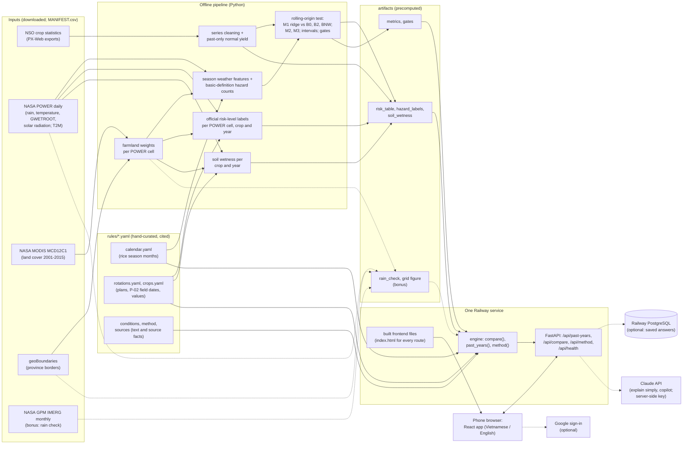
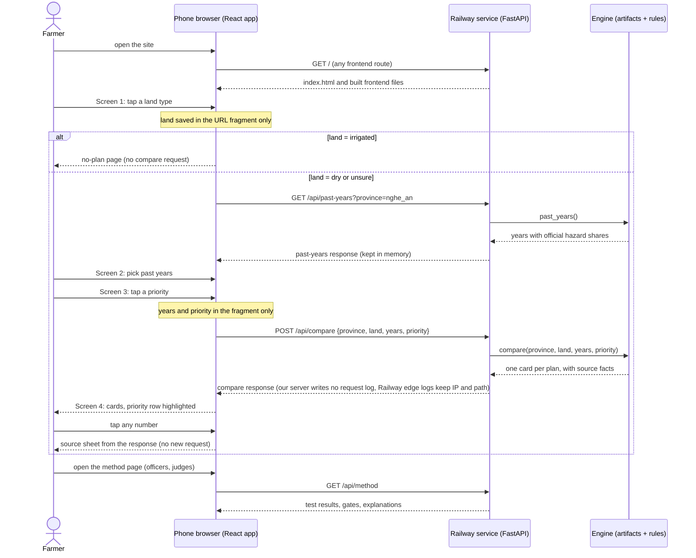
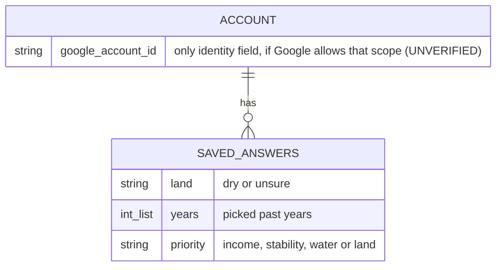

# Architecture

This file describes the technical design: the architecture, the modules, the decision logic, testing and deployment.
Its change history is in git. The API contract is defined in one place, docs/UI-UX-SPEC.md §11; this file mirrors it,
and docs/DATA-DICTIONARY.md defines the artifacts and rules files that feed it. "(routine)" marks a routine technical
choice that Claude made.

## 1. Architecture

The offline pipeline, the comparison engine and the backend are all Python, and they live in this repository together
with the React frontend. The deployed app runs as a single Railway service.



Solid arrows show the core flow. Dotted arrows show optional features, which come after the core. The rain check
(the IMERG input and `rain_check` in A3) was planned and is not in the built code: the IMERG download stopped at 194 of
288 monthly files, so the check was not run, and `GET /api/method` returns `rain_check` as null. The official
risk-level labels and the soil wetness values are computed for each POWER cell over each crop's P-02 field dates and
then weighted by farmland (DATA-DICTIONARY §4b, §4d). The season weather features use the calendar months instead
(DATA-DICTIONARY §6b). At run time the app reads only the precomputed artifacts and the rules files, and it makes
outside calls only for the optional features (NFR-01). The optional AI features are the one exception to the rule of
no live external calls. Their Claude API key is kept only in the server environment, and the copilot runs in
extractive mode: the model returns only the ids of sourced passages, and the server checks those ids and shows the
passages word for word with their source buttons.

The sequence diagram below shows the requests of the core flow (UI-UX-SPEC §6b, §11; the privacy settings are in §10
below). The farmer's answers are kept only in the URL fragment, which browsers never send to a server, and they reach
the server only in the body of the compare request.



The next diagram shows the data kept for the optional sign-in (UI-UX-SPEC §12c), which is limited to what the spec
allows us to store. One account can keep up to 20 saved sets of answers, and a 21st save is refused, so one account
links to many saved sets. That we store only Google's account id is marked [UNVERIFIED], as in §12c, because it holds
only if Google allows that scope. When a signed-in farmer saves the answers, the prices and costs typed in "your price
and costs" (UI-UX-SPEC §12d) are saved with them and come back when the set is reopened. Without a save, they stay in
the page address only.



- The pipeline writes small, versioned JSON artifacts, plus CSV tables in `data/processed/` that git ignores. The app
  never calls NASA, NSO or a model live (NFR-01).
- The engine is a pure-Python package with no UI imports. Its entry point is
  `compare(province, land, years, priority) -> CompareResponse`. It has unit tests, and its output schema mirrors the
  API contract of UI-UX-SPEC §11.
- The app is a FastAPI backend that loads the precomputed artifacts and runs `compare()` for each request. The React +
  Vite + TypeScript frontend is specified in docs/UI-UX-SPEC.md, and the API contract is UI-UX-SPEC §11. The FastAPI
  app also serves the built frontend as static files, so frontend and API are one deployment (routine). It returns
  `index.html` for every other path outside `/api`, so deep links work. The frontend uses hash routes; the URL fragment
  holds the farmer's answers and never reaches the server (routine). The app is hosted on Railway, Hobby plan. The
  fallback for judging is a static snapshot of real API responses; the placeholder fixtures are never shown as
  results. Streamlit is not used.

tests/test_architecture.py enforces the layer rules: `data` imports no other layer; `features` may import `data`; `ml`
may import `data` and `features`; `engine` imports no layer and reads rules and artifacts only; `api` imports `engine`
only.

We chose this split so that the pipeline and the engine stay in Python. Because the engine does not depend on the UI,
the choice of UI does not affect the science code.

## 1a. Quality goals and main architecture decisions

The quality goals below come from the requirements in SRS.md and the hard rules of UI-UX-SPEC §4.
1. Scientific honesty. Every displayed number has a source and source facts (NFR-09), the app makes no forecast (H13),
   and it makes no farm-level claim (FR-02).
2. No leakage in the model test. Nothing from a test year is used in fitting (NFR-08).
3. A first-time farmer can use it on a phone. The screens work at 360 px with large tap targets and text (NFR-04,
   NFR-05), and there is nothing to type (H4).
4. Privacy. The farmer routes hold no personal data, and the answers stay in the URL fragment until the compare request
   (NFR-06).
5. Reproducibility. Each stage runs with one command, versions are pinned and the data files are checksummed (NFR-02).

The main architecture decisions are these:
- All science runs offline, and the app reads only precomputed result files (NFR-01).
- We use a live Python backend rather than a static site, so the comparison logic exists only once, in Python.
- The app runs as one Railway service in which FastAPI serves both the API and the built React files (a routine
  choice). The optional sign-in keeps its saved answers in a separate Railway PostgreSQL database.
- The comparison engine is pure Python with no UI imports, and its output schema mirrors the API contract of
  UI-UX-SPEC §11.
- Plans, crop values and rule texts are kept in hand-curated rules files, with a source for every value, instead of in
  code.
- The farmer's answers are kept in the URL fragment, so a link reopens the same comparison and no account is needed.

## 1b. Scaling principle

Some inputs cover the whole world: NASA POWER, MODIS land cover, geoBoundaries and the ETCCDI indices. The other inputs
are specific to one country, and together we call them a "country adapter". For Vietnam they are the regional harvest
statistics (read by the NSO PX-Web parser), the crop calendar (the NSO calendar in rules/calendar.yaml, read by
features/season_windows.py), and the crop-option evidence and official hazard definitions (in the rules files). The
design keeps these inputs behind separate modules, so another country can be added by supplying its own inputs. Only
Vietnam is built for the hackathon.

## 2. Repository layout (target)

```
CLAUDE.md                 operating instructions + context index
docs/                     specs, data sources, references, glossary, test plan
rules/                    rotations.yaml, crops.yaml (incl. cited water facts), calendar.yaml, conditions.yaml,
                          method.yaml, sources.yaml (schemas: DATA-DICTIONARY §6-§8)
src/fieldshift/
  data/                   nso.py (PX-Web export parsing), power.py (POWER client + cache), admin.py (crosswalk)
  features/               season_windows.py (reads rules/calendar.yaml), climate.py (ETCCDI, official conditions), feature_table.py
  ml/                     splits.py, normal.py, baselines.py, models.py, evaluation.py, export.py
  engine/                 schemas.py (pydantic), rules.py (load + validate), compare.py
  api/                    FastAPI backend serving engine results
frontend/                 React + Vite + TypeScript: src/i18n/, src/api.ts
data/raw/                 downloads (gitignored), with data/MANIFEST.csv (committed: url, date, sha256)
data/reference/           admin_units.csv (NSO names, 2025 status; DATA-DICTIONARY §1) and its SOURCES.md
data/processed/           tidy CSV tables (gitignored, reproducible; cell_weights.csv is committed): crop_stats.csv,
                          cell_weights.csv, training_table.csv with the season climate columns (DATA-DICTIONARY
                          §2-§4c)
artifacts/                small app inputs, committed: risk_table.json, hazard_labels.json, metrics.json, gates.json,
                          soil_wetness.json, rain_check.json, figures/nghe_an_grid.svg (DATA-DICTIONARY §4d, §5c)
tests/                    pytest
```

This was the planned layout, and the built code differs from it: `ml/` holds evaluation.py, export.py, figures.py,
fold_features.py, grid_figure.py, normal.py, primary_test.py, reports.py, results_chart.py and runner.py, `data/` has
no admin.py, and there is no `artifacts/rain_check.json`, because the IMERG download stopped at 194 of 288 monthly
files and the rain check was not run.

The TCVN text and the FAO .CRO files are never committed; we quote individual values with their source. There is no
water-balance module, no water-deficit artifact and no price artifact.

## 3. Module interfaces (provisional; final schemas are written tests-first)

The API contract, with its JSON shapes and endpoints, is defined in docs/UI-UX-SPEC.md §11, and that definition is
authoritative. The engine schemas mirror it one to one in pydantic, and their final versions are written tests-first.

```python
# engine/schemas.py (provisional, mirrors UI-UX-SPEC §11)
Lang = Literal["vi", "en"]
Text = dict[Lang, str]  # {"vi": str, "en": str}; data-dependent text only (UI-UX-SPEC H15)
Province = Literal["nghe_an"]  # mapped to unit_id VN-NA (DATA-DICTIONARY §1)
Land = Literal["dry", "unsure"]  # the fragment value "irrigated" never reaches the API (UI-UX-SPEC §6b)
Priority = Literal["income", "stability", "water", "land"]  # single most important priority
PlanId = Literal["usual", "usual_p03", "cc1", "cc2", "cc3", "cc4"]  # this order
SeasonCode = Literal["spring", "summer_autumn", "winter", "autumn_winter"]  # windows: UI-UX-SPEC §11
RuleCode = Literal["heavy_rain", "heat", "drought_rain_consecutive", "drought_rain_any2", "cold"]
ModelStatus = Literal["shown", "not_shown", "not_modeled"]
ModelId = Literal["b0", "b2", "bnw", "m1_ridge", "m2_lgbm", "m3_rf"]
Sensitivity = Literal["no_fao_flagged", "mae_skill", "risk_level_features", "window", "centroid_points"]
CoverageAxis = Literal["money", "conditions", "rice_history", "model", "water_tcvn", "water_fao"]
ExplainKey = Literal["evapotranspiration", "soil_moisture", "ndvi", "frost", "water_balance", "data_types"]
# SourceFacts, Value, Season, Rule, YearRow, PastYearsResponse, CropSpan, Period, MoneyItem, Money, CropExposure,
# StabilityYear, Stability, WaterFact, LandCheck, LandCare, RiskItem, Why, Plan, CompareRequest, Interval, GateRow,
# CompareResponse, MetricRow, WeatherClaim, ReportItem, CoverageCell, ExplainTerm, MethodResponse, HealthResponse:
# same fields and types as UI-UX-SPEC §11 (TypeScript `T | null` = Python `T | None`).


def past_years(province: Province) -> PastYearsResponse: ...
def compare(province: Province, land: Land, years: list[int], priority: Priority) -> CompareResponse:
    ...
    # plan order fixed; land and priority are echoed in `request` and change nothing else


def method() -> MethodResponse: ...
def health() -> HealthResponse: ...
```

The endpoints are `GET /api/past-years?province=nghe_an`, `POST /api/compare` (JSON body `CompareRequest`: province,
land, years, priority), `GET /api/method` and `GET /api/health` (UI-UX-SPEC §11). Invalid input gets HTTP 422
(routine): an unknown province, land or priority, an empty years list, or years that are not strictly ascending or fall
outside 1995-2024. Source ids are either REFERENCES ids (`R-` ids, e.g. `R-P02`) or, for our own computations,
computation ids (`E-` followed by three digits and an optional lowercase letter), and each has its entry in
rules/sources.yaml. The engine does the rounding. Computed shares and anomalies become whole percent, rounded half up
(`decimal.ROUND_HALF_UP`, routine), and sourced numbers keep the source's precision. The output has no score, no
weights, no grades, no percentile bands and no hidden plans. The API carries no copy of a fixed sentence: the support
note, data line, computed note, trial note, total note and card warnings are frontend i18n keys (UI-UX-SPEC H15, §11).

## 4. Decision logic (deliberately simple)

1. No filtering by water. All plans are shown, because no source says which water situation rules out a P-02 plan, and
   all of them were tested on the same drought-prone land type.
2. Assemble the rows of each plan card from the artifacts and the rules files.
   Money: for each crop, the P-02 Table 13 net profit including labour and the total cost from Tables 4, 8 and 12, all
   from one study with one profit definition. The whole-year total is the sum of the profit values and is labelled as
   our arithmetic. The price year is a data field (2020-21 for P-02). The P-03 card shows text only, with its own
   definition.
   Stability: for each crop, the official-condition shares for each picked year, taken from the `level` `crop` hazard
   rows. For rice, the row also shows the real NSO anomaly for each picked year, or "not available" when there is no
   normal. The out-of-sample prediction appears next to it only for the test years where that season's test passed,
   and the 80% range only where G4 passed. The summary is the min, median and max over the non-null real values plus
   the worst years (those equal to the minimum), or each year on its own when fewer than 2 values are non-null. The
   median of an even number of years is the mean of the two middle exact values, rounded once to a whole percent; the
   years are never rounded first. The row also carries the years count and the scope text. `model_status` for each
   season comes from risk_table: summer-autumn rice is `not_modeled` (history only, because G1 fails). Non-rice crops
   have no Stability entry, and their card shows `stability.noData`.
   Water: the drought rain-part shares for each crop, plus the TCVN 8641:2011 "to apply" amounts and the FAO TM3 Table
   14 "crop uses" values where the source lists the crop, each with its scope. A rice crop shows only the TCVN 8641 rows
   of its own season. Any other crop with no listed value gets one `not_listed` line.
   Calendar: the P-02 date ranges and the bare periods. A bare period is the days covered by no span from sowing start
   to harvest end (FR-18), and a period over 31 December is one wrapping Period. P-03 has no dates.
   Land care: three separate checks, with no score. The first is the number of different crops in the year, citing the
   FAO Conservation Agriculture principle "at least three different crops" with its context, crop sequences in
   conservation agriculture. The second is the days with a living crop out of 365, citing NRCS "Maximize Continuous
   Living Roots". The third is whether a legume is grown, with the Witcombe and Tiemann 2022 residue caveat and its
   "<70% BNF efficiency" qualifier. The checks are structured values (`LandCare`, UI-UX-SPEC §11), and their sentences
   are frontend i18n keys. Days with a living crop need no partial-month rule. Bare months are not presented as erosion
   (Slaets et al. 2016).
   Every response also carries what its source sheets need, so a shared `/phuong-an` link works on its own: the
   `sources` map, the rule texts (`rules`), the season labels and the gate verdicts of the shown seasons (UI-UX-SPEC
   §11).
3. Comparability. Nothing is ranked, so there is no separate comparability field. The contract itself marks
   non-comparable evidence: P-03 money is `text_only` with its own definition, water lines carry their `measure`, and
   missing values are `null` or "not listed" and are never imputed.
4. Display (UK DCLG Multi-criteria analysis manual 2009). Each plan gets one card, and all cards have the same rows in
   real units. There is no weighted score, no min-max normalization, no tie rule and no dominance flags (unreplicated
   plots give no error estimate). The priority only highlights its row. The P-02 limitations are attached: single
   unreplicated 1,000 m2 plots over one year, an unknown plot layout, reported date overlaps, a conflict between the
   methods list and the results tables on CC2-CC4, and two identical Table 4 rows.
5. There is no optimizer and no search over sequences. The catalog holds only the P-02 structures (CC1-CC4 and the
   farmers' usual CC5) plus the P-03 local control (rice - rice - fallow), and each is described as "each crop tested
   in its season on this land type (P-02, 2020-21)". No assembled plans are shown.

## 5. Trust labels

Each number shows facts about its source only: the source name, the study type (e.g. one unreplicated trial field,
national statistics, official standard, NASA reanalysis, or our model with its gate results), the place, the years,
whether it was replicated, and whether we read the full text. There are no grade letters and no confidence words.

## 6. Pipeline commands (target)

```
python -m fieldshift.pipeline ingest      # NSO exports -> data/processed/crop_stats.csv
python -m fieldshift.pipeline climate     # POWER download (cached) -> training_table.csv climate columns + hazard_labels.json
python -m fieldshift.pipeline train       # experiments -> artifacts/metrics.json, artifacts/gates.json (DATA-DICTIONARY §5b)
python -m fieldshift.pipeline export      # -> artifacts/risk_table.json
PYTHONPATH=src uvicorn fieldshift.api.app:app --no-access-log   # backend; Dockerfile and railway.json deploy it
bash scripts/reproduce.sh                                       # every stage from the public downloads (CR-07)
pytest
```

The four `python -m fieldshift.pipeline` commands were planned and are not in the built code, which has no
`fieldshift.pipeline` module; instead each stage is a script in `scripts/` (for example build_crop_stats.py,
build_training_table.py, run_primary_test.py, export_risk_table.py and export_crop_exposure.py), and
scripts/reproduce.sh runs them in order.

## 7. UX and accessibility rules

All UX rules, with their sources and automated tests, are in docs/UI-UX-SPEC.md §4-§5 and §14.

## 8. Testing strategy

The testing strategy is in docs/TEST-PLAN.md: the test levels, the tools, what each area checks, the gates and the
manual checks.

## 9. Deployment and demo

The backend runs on Railway on the Hobby plan, which we signed up for before the first deployment. The Dockerfile
installs the package into site-packages and sets `FIELDSHIFT_ROOT=/app`, so the service reads /app/rules and
/app/artifacts (src/fieldshift/paths.py; tests/test_paths.py checks the installed case). The FastAPI service serves the
built frontend files and returns `index.html` for every frontend route. `GET /api/health` reports each artifact's
`schema_version` and `generated_at`. If the deployment fails, the fallbacks are the bundled default result and a local
run.

Demo-day runbook (Sunday, member A). Before the judging slot, open `/api/health` and the four farmer screens on a
phone. If the deployment fails, use the static snapshot of real responses or run locally with the commands in the
README (build the frontend first). Keep the slides and the snapshot open offline. The API is documented by the typed
contract in UI-UX-SPEC §11, and the automatic OpenAPI page is switched off in the app.
No other paid services are used without approval.

## 10. Privacy settings for deployment

- uvicorn runs with `--no-access-log`, and the app logs no request paths, bodies or IP addresses.
- The Railway service region is Singapore. Railway's own edge logs still record the visitor's IP and path for their
  retention period (Free 3 days, Hobby 7 days; R-J20). The answers are never in the path, because the pages keep them in
  the URL fragment and the compare request sends them in the POST body.
- The saved answers of signed-in farmers (optional, UI-UX-SPEC §12c), with any typed prices and costs, are stored in
  the database, and all of it is deleted on request.
