# Miaudow: kịch bản thuyết trình (5–7 phút)

Tổng thời gian khoảng 6 phút. Mỗi phần có: thời gian, **trang cần mở**, ảnh màn hình để biết đúng chỗ, và lời nói.

Video demo 30 giây: [tiếng Việt](miaudow-demo-30s-vi.mp4) · [tiếng Anh](miaudow-demo-30s-en.mp4).

Các đường dẫn bên dưới tính từ địa chỉ của app (ví dụ `http://127.0.0.1:8000/`). App dùng đường dẫn có dấu `#`. Gõ thiếu `#` thì trang sẽ trắng.

---

## 0:00 – 0:30 · Mở đầu: chiếu video

**Mở:** file `miaudow-demo-30s-vi.mp4`.

> Kính chào ban giám khảo. Chúng em là đội Miaudow, thử thách **Field Shift**.

---

## 0:30 – 1:15 · Vấn đề

**Mở:** Trang chủ `/#/`, kéo xuống phần thứ hai "Đất lúa kém hiệu quả, thường xuyên khô hạn".

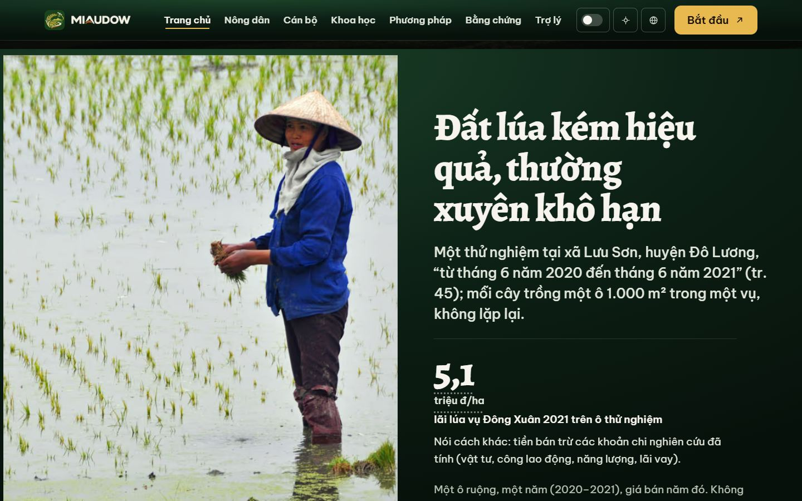

> Ở Nghệ An có nhiều ruộng lúa thiếu nước: ruộng cao, ruộng cuối kênh, ruộng hay hạn.
>
> Người nông dân muốn biết: mùa tới mình có nên đổi cách trồng không? Trồng lúa, hay xen lạc, đậu, ngô?
>
> Thông tin để trả lời câu đó có thật, nhưng nằm rải rác: số liệu thời tiết của NASA, bài báo khoa học, quy định của nhà nước. Bà con khó tự đọc hết.

---

## 1:15 – 1:45 · Giải pháp trong một câu

**Mở:** Trang chủ `/#/`, phần đầu trang.

> Miaudow đặt **hơn 30 năm thời tiết NASA** cạnh **6 cách trồng đã thử ở Đô Lương**, để mỗi gia đình **tự so sánh** trước mùa tới.
>
> Miaudow không ra lệnh trồng gì. Ứng dụng chỉ cho xem và so sánh, rồi gợi ý câu hỏi để mang tới cán bộ khuyến nông.

---

## 1:45 – 2:30 · Bốn lõi AI

**Mở:** Trang chủ, bấm "Bốn lõi AI làm gì?" (hoặc kéo xuống phần "Bốn lõi AI, một nguồn dữ liệu").

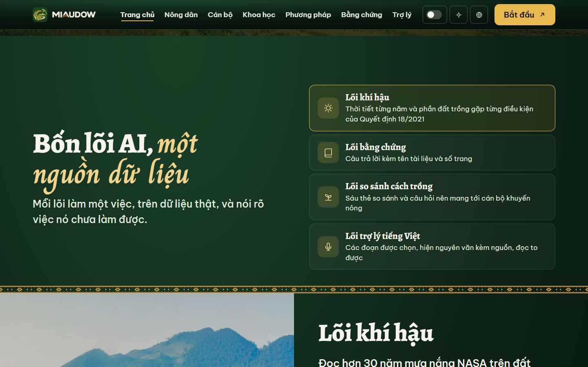

> Miaudow có 4 lõi. Mỗi lõi làm một việc và nói rõ việc nó chưa làm được.
>
> 1. **Lõi khí hậu:** đọc 30 năm mưa nắng NASA trên đất trồng Nghệ An, theo ngưỡng hạn, nóng, rét của Quyết định 18/2021. Lõi này không dự báo mùa tới.
> 2. **Lõi bằng chứng:** tìm đúng đoạn tài liệu, kèm tên tài liệu và số trang. Không tìm thấy thì nói "chưa có nguồn".
> 3. **Lõi so sánh cách trồng:** đặt 6 cách trồng cạnh nhau, không chấm điểm, không xếp hạng.
> 4. **Lõi trợ lý tiếng Việt:** nghe câu hỏi bằng giọng nói hoặc chữ, trả lời bằng đúng đoạn trong dữ liệu, kèm nguồn.

---

## 2:30 – 3:45 · Dành cho nông dân: 4 lần chạm

**Mở:** Trang chủ, bấm nút vàng "Tìm hiểu ruộng nhà mình", rồi đi qua 4 bước.

> Phần nông dân chỉ cần 4 lần chạm, không phải gõ chữ.

**Bước 1. Ruộng nhà mình thế nào?** `/#/nong-dan/ruong`

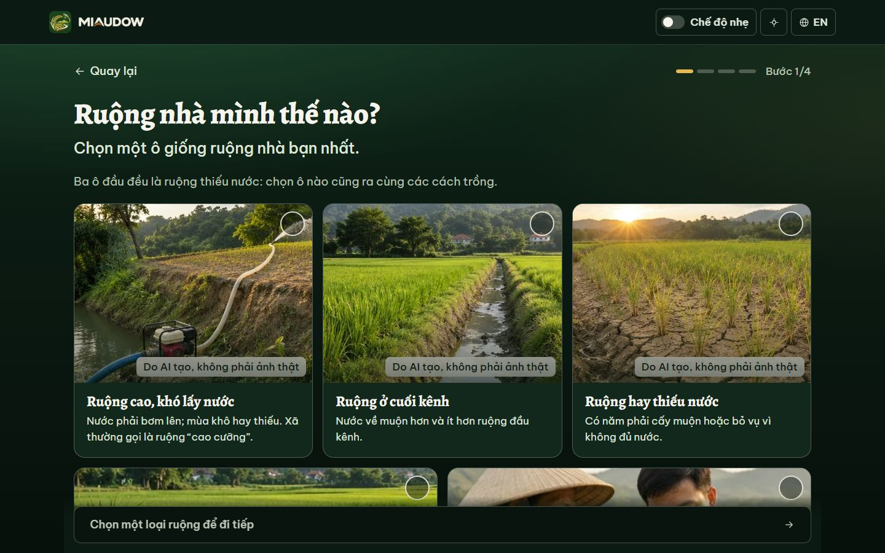

> Chọn tranh giống ruộng nhà mình: ruộng cao, cuối kênh, hay thiếu nước. Tranh do AI vẽ và có ghi rõ như vậy.

**Bước 2. Những năm trước ra sao?** Chọn "Ruộng ở cuối kênh" để sang bước này.

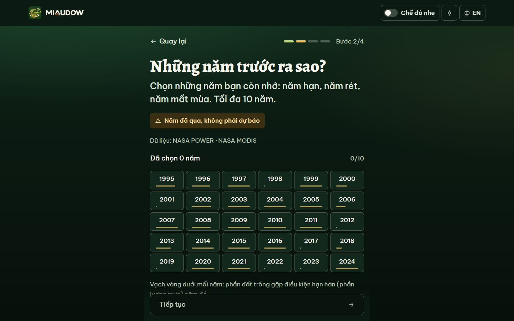

> Chọn năm hạn, năm rét bà con còn nhớ. Dữ liệu NASA cho xem lại năm đó.

**Bước 3. Gia đình quan tâm điều gì nhất?**

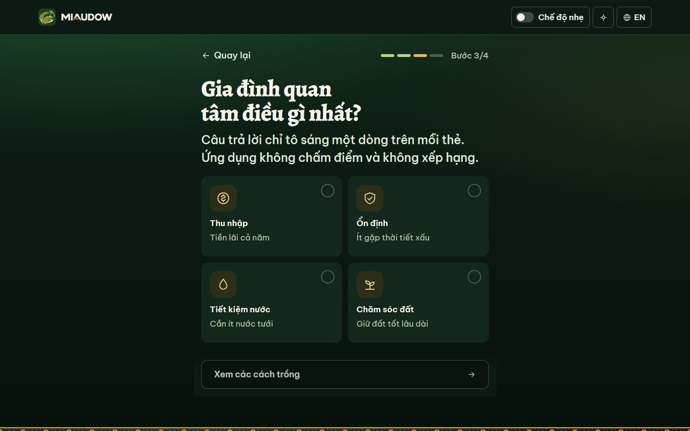

> Thu nhập, ổn định, nước tưới hay đất. Ứng dụng chỉ tô sáng phần đó, không xếp hạng.

**Bước 4. So sánh 6 cách trồng.** Mở nhanh: `/#/nong-dan/phuong-an?ruong=canal_end&nam=2010,2020&uutien=income`

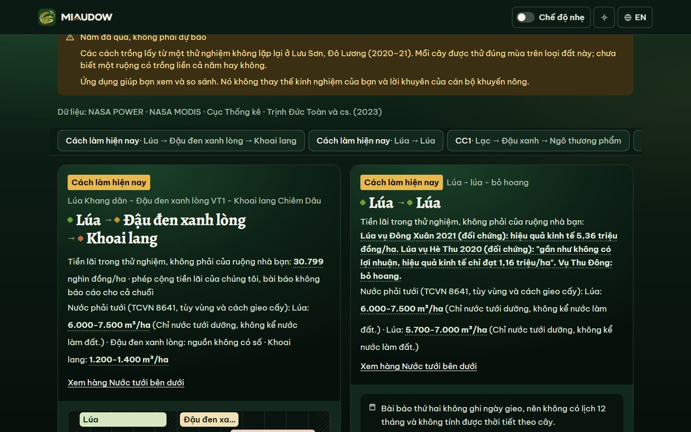

> Mỗi thẻ có lịch 12 tháng, tiền lãi trên ô thử nghiệm, lượng nước tưới theo tiêu chuẩn TCVN 8641, và câu hỏi nên mang tới cán bộ.
>
> Mọi con số đều bấm vào được để xem nguồn.

---

## 3:45 – 4:30 · Khoa học và đài quan sát 3D

**Mở:** trang **Khoa học** `/#/khoa-hoc`.

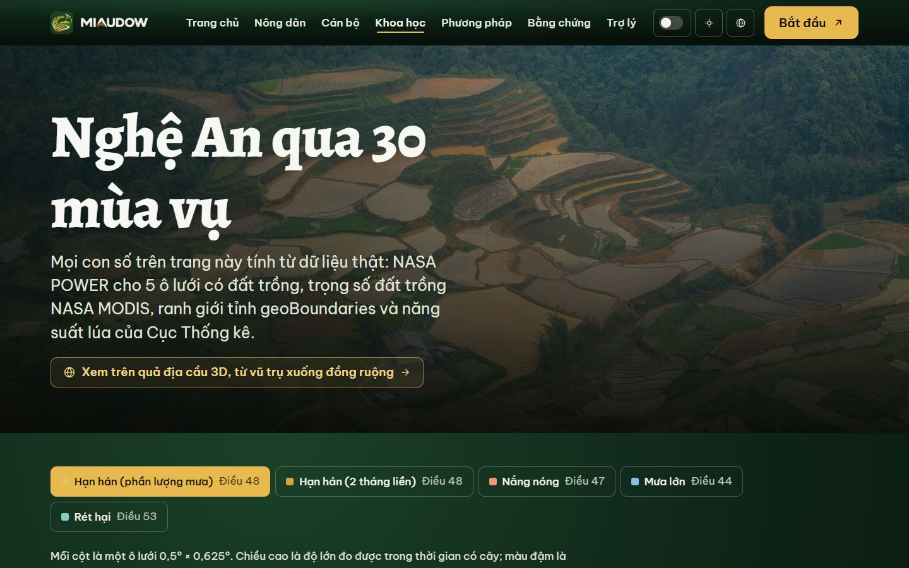

> Trang Khoa học cho xem 30 năm khí hậu trên bản đồ Nghệ An, chia theo ô lưới NASA POWER.

**Mở:** **Đài quan sát 3D**, cảnh vệ tinh: `/#/dai-quan-sat?canh=satellites` (đợi vài giây cho quả địa cầu tải).

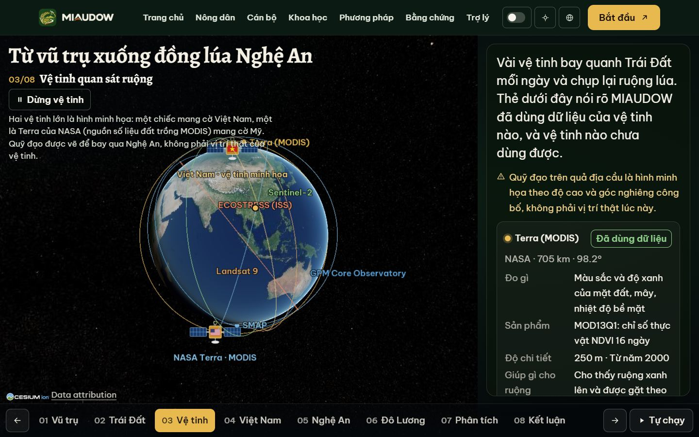

> Đài quan sát 3D đi từ vũ trụ xuống tới ruộng Đô Lương. Hai vệ tinh minh họa bay qua Nghệ An: một chiếc mang cờ Việt Nam, một chiếc là NASA Terra. Terra mang thiết bị MODIS, là nguồn số liệu độ xanh của cây trồng mà chúng em dùng.
>
> Máy yếu thì có bản nhẹ: cảnh vệ tinh vẽ bằng hình phẳng, không cần 3D.

---

## 4:30 – 5:15 · Trung thực với dữ liệu

**Mở:** trang **Bằng chứng** `/#/bang-chung`.

> Trang Bằng chứng nối mỗi kết luận tới con số, phép tính và trang tài liệu gốc.

**Mở:** Trang chủ, phần "Chúng tôi nói rõ cả khi mô hình không thắng". Chi tiết đầy đủ ở trang **Phương pháp** `/#/phuong-phap`.

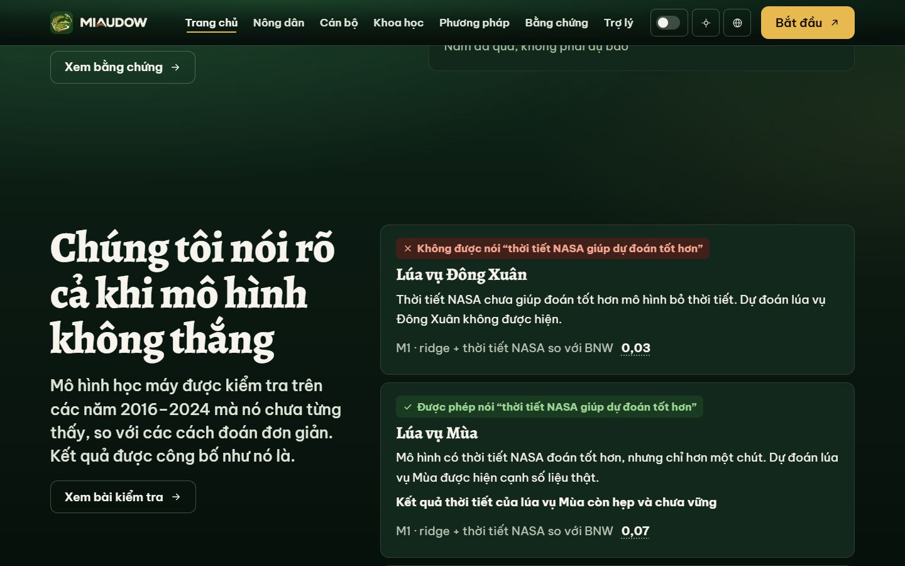

> Chúng em có thử một mô hình học máy dùng thời tiết NASA để đoán năng suất lúa. Bài kiểm tra chạy trên các năm 2016–2024 mà mô hình chưa từng thấy.
>
> Với lúa vụ Đông Xuân, thời tiết NASA **chưa giúp đoán tốt hơn**, nên ứng dụng **không hiện** dự đoán đó. Chúng em công bố kết quả đúng như nó là.

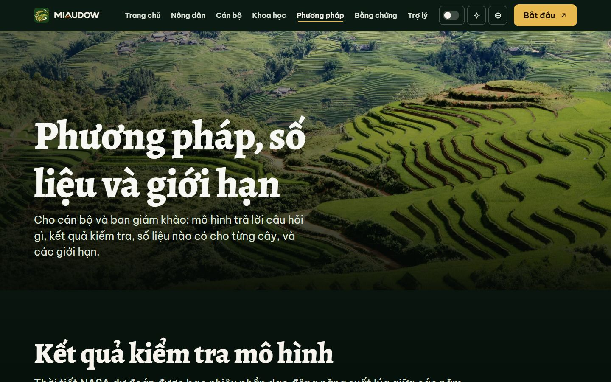

---

## 5:15 – 5:45 · Cho cán bộ, trợ lý, và dùng được ở mọi nơi

**Mở:** trang **Cán bộ** `/#/can-bo`.

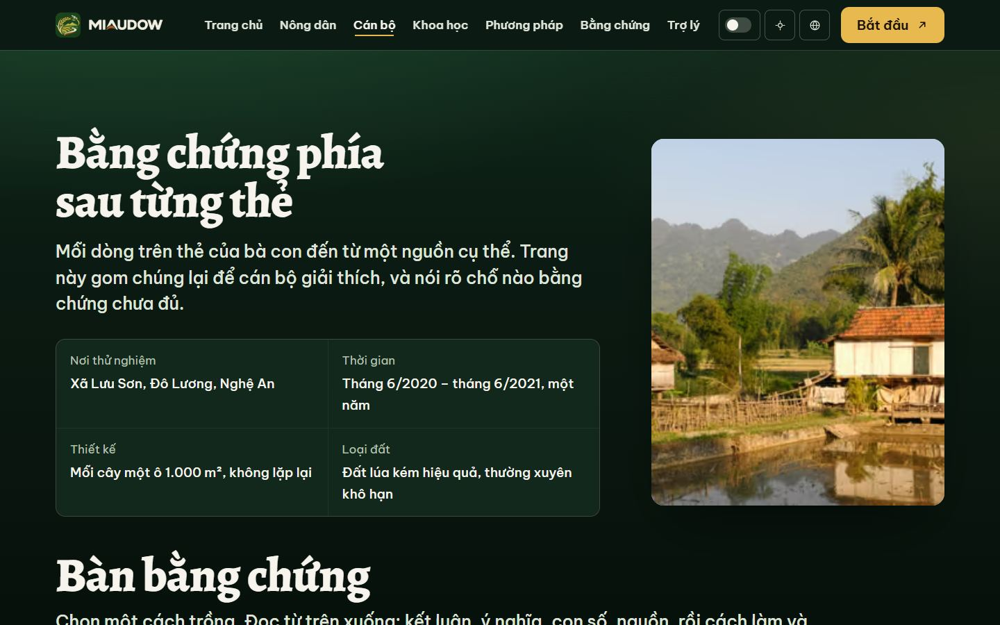

> Trang Cán bộ gom bằng chứng của từng cách trồng để cán bộ khuyến nông giải thích cho bà con.

**Mở:** **Trợ lý** `/#/tro-ly`, gõ hoặc bấm "Nói" để hỏi, ví dụ: "Ruộng cuối kênh thiếu nước vụ xuân thì nên làm gì?"

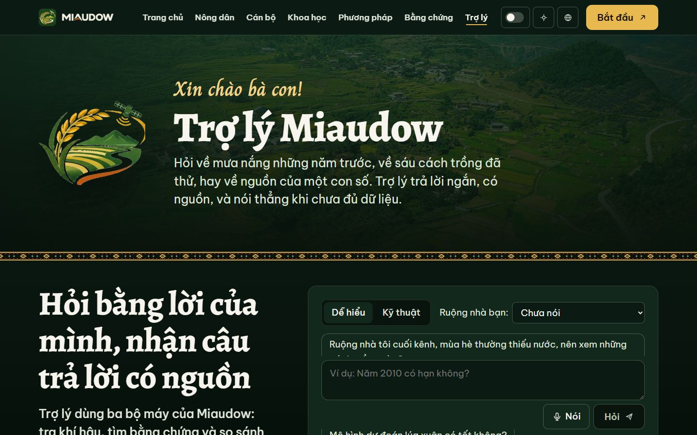

> Trợ lý trả lời bằng đúng đoạn trong dữ liệu của Miaudow, kèm nguồn, và đọc to được.

**Chỉ lên thanh trên cùng:** công tắc "Chế độ nhẹ" và nút "EN" (xem ảnh đầu trang chủ ở trên).

> Ứng dụng có tiếng Việt và tiếng Anh, có **chế độ nhẹ** cho điện thoại yếu, có **bản ngoại tuyến**, không cần tài khoản và không lưu gì trên máy của bà con.

---

## 5:45 – 6:15 · Giới hạn và bước tiếp theo

> Giới hạn của chúng em: mỗi cách trồng mới thử trên một ô ruộng, trong một năm. Trợ lý chưa thử với giọng nói Nghệ An.
>
> Bước tiếp theo: thử với nông dân thật ở Lưu Sơn, và thêm dữ liệu thử nghiệm nhiều năm hơn.

---

## 6:15 – 6:30 · Kết

**Mở:** Trang chủ `/#/`.

> "Đường vô xứ Nghệ quanh quanh, non xanh nước biếc như tranh họa đồ." Chúng em mong mỗi mùa vụ ở xứ Nghệ được bắt đầu bằng thông tin rõ ràng hơn.
>
> Cảm ơn ban giám khảo đã lắng nghe.

---

## Mẹo trình bày

- Nói chậm và chỉ vào màn hình. Mỗi tính năng chỉ cần một câu nói nó làm gì, và một câu nói nó chưa làm được gì.
- Nếu giám khảo hỏi về tiền lãi: chỉ nói số của **một** nghiên cứu (lãi lúa vụ Đông Xuân 2021 trên ô thử nghiệm). Không so lãi giữa hai bài báo, vì hai bài tính lãi khác nhau.
- Nếu bị hỏi về dữ liệu: NASA POWER (mưa, nắng, nhiệt độ), NASA MODIS (độ xanh cây trồng), CHIRPS (mưa), Cục Thống kê (năng suất), hai nghiên cứu ở Lưu Sơn, Quyết định 18/2021, TCVN 8641.
- Ảnh trong ứng dụng có giấy phép mở (Wikimedia Commons, có ghi tác giả). Tranh ruộng do AI vẽ và có ghi rõ.

## Về video demo

- Hai video dài 30 giây, 1920×1080: giao diện thật của app (chụp ngày 15/11/2026), chữ chạy, ảnh ruộng bậc thang có giấy phép mở và logo của đội.
- Nhạc nền do đội tự tổng hợp bằng máy (thang ngũ cung, tiếng gảy giống đàn tranh), không dùng nhạc của người khác.
- Ảnh trong video: "terrace-sunset-reflection" (Vietnam Photo Tours | An Bui, CC BY 2.0) và "ha-giang-golden-terraces-clouds" (minhphuc_99kdd, public domain), cả hai từ Wikimedia Commons, đã chỉnh màu nhẹ. Tên tác giả và giấy phép đầy đủ nằm trong `frontend/src/data/generated/media.json`.
- Các ảnh màn hình trong thư mục `img/` chụp từ app chạy trên máy, nhánh `main` cộng PR #74 (ảnh đầu trang Phương pháp).

---

## Chi tiết phân tích: hỏi – đáp khi ban tổ chức hỏi

Mỗi câu trả lời đọc được trong 20–40 giây. Con số lấy từ app và tài liệu của dự án (`docs/ML-DESIGN.md`, `docs/DATA-SOURCES.md`).

### 1. Dữ liệu lấy từ đâu?

> - **NASA POWER:** mưa, nắng, nhiệt độ hằng ngày, 1995–2024, theo ô lưới 0,5° × 0,625° (khoảng 55 × 66 km).
> - **NASA MODIS (Terra, sản phẩm MOD13Q1):** độ xanh cây trồng (NDVI), độ chi tiết 250 m, 16 ngày một lần. Chúng em nạp 10 năm quanh Lưu Sơn (2015–2024).
> - **CHIRPS:** mưa, để đối chiếu với NASA POWER.
> - **Cục Thống kê (bảng E06):** năng suất lúa theo tỉnh, 1995–2024.
> - **Hai nghiên cứu ở Lưu Sơn, Đô Lương:** kết quả thử nghiệm các cách trồng 2020–2021.
> - **Quyết định 18/2021** (ngưỡng hạn, nóng, rét, mưa lớn) và **TCVN 8641** (lượng nước tưới).

### 2. "6 cách trồng" là gì?

> - 2 cách đang làm hiện nay: lúa – lúa, và một chuỗi có lúa.
> - 4 cách trồng thử, CC1 đến CC4, ví dụ lạc → đậu xanh → ngô.
> - Tất cả lấy từ một thử nghiệm ở xã Lưu Sơn, từ tháng 6/2020 đến tháng 6/2021. Mỗi cây trồng một ô 1.000 m², không lặp lại.
> - Vì vậy app luôn ghi: "một ô ruộng, một năm, không phải tiền lãi dự kiến của nhà bạn".

### 3. Mô hình học máy dự đoán cái gì?

> - Câu hỏi của mô hình: "Thời tiết NASA giải thích được bao nhiêu phần dao động năng suất lúa giữa các năm, ở cấp tỉnh?"
> - Mô hình **không** dự đoán năng suất của từng ruộng, và **không** dự báo mùa tới.
> - Mục tiêu: độ lệch năng suất (%) so với trung bình 3 năm trước đó, theo từng tỉnh và từng vụ lúa.
> - Dữ liệu huấn luyện: 3.961 dòng năng suất lúa của 64 tỉnh (vụ Đông Xuân 1.827, Hè Thu 514, vụ Mùa 1.620).

### 4. Mô hình là gì, so với cái gì?

> - **M1:** hồi quy ridge trên các đặc trưng thời tiết NASA, chuẩn hóa trong từng lần chia dữ liệu. Mô hình phụ: LightGBM và rừng ngẫu nhiên.
> - Ba mốc so sánh:
>   - **B0:** trung bình nhiều năm.
>   - **B2:** lấy năm trước.
>   - **BNW:** cùng mô hình nhưng bỏ hết thời tiết.
> - Thời tiết NASA chỉ được ghi công khi M1 thắng **BNW**.

### 5. Kiểm tra thế nào để không "ăn gian"?

> - Kiểm tra theo kiểu **rolling origin trên 2016–2024**: mỗi năm kiểm tra chỉ dùng dữ liệu các năm trước đó để học.
> - Điểm kỹ năng = 1 − (sai số của mô hình ÷ sai số của mốc so sánh).
> - Khoảng tin cậy 90% được tính bằng cách lấy mẫu lại theo **cả năm**, vì các tỉnh gần nhau có chung thời tiết.
> - Luật đạt/không đạt được viết **trước khi** nhìn kết quả.

### 6. Kết quả ra sao?

> - **Lúa vụ Đông Xuân:** điểm hơn BNW chỉ 0,03, chưa chắc chắn. Vì vậy app **không hiện** dự đoán vụ này và không nói "thời tiết NASA giúp đoán tốt hơn".
> - **Lúa vụ Mùa:** điểm hơn BNW 0,07, chỉ hơn một chút. Dự đoán được hiện **cạnh** số liệu thật, không thay số liệu thật.
> - **Lúa Hè Thu:** chỉ có 18 tỉnh đủ số liệu, chưa đủ 25 tỉnh theo luật, nên không làm mô hình mà chỉ hiện số liệu thật.

### 7. "20 trong 30 năm hơn nửa đất trồng gặp hạn" tính thế nào?

> Mỗi năm 1995–2024, chúng em đếm phần đất trồng lúa Nghệ An (theo ô lưới NASA POWER) gặp điều kiện hạn của Quyết định 18/2021 **trong lúc có cây trên ruộng**. Có 20 năm mà phần đó vượt quá một nửa. Đây là năm đã qua, không phải dự báo.

### 8. AI ở đâu trong sản phẩm? Có bịa câu trả lời không?

> - Bốn lõi AI gồm: khí hậu, bằng chứng, so sánh và trợ lý.
> - Trợ lý **không viết câu trả lời mới**. Nó chọn các đoạn có sẵn trong dữ liệu của Miaudow, rồi hiện **nguyên văn** kèm nguồn.
> - Khi máy chủ có khóa, Claude (AI của Anthropic) chỉ được dùng để **chọn đoạn**. Không có khóa thì dùng tìm kiếm theo từ ngữ.
> - Không tìm thấy thì trợ lý nói "chưa có nguồn".

### 9. Tiền lãi trên thẻ đáng tin đến đâu?

> - Đó là tiền lãi của **một** nghiên cứu, trên ô thử nghiệm, với giá bán năm đó. Ví dụ: lãi lúa vụ Đông Xuân 2021 khoảng 5,1 triệu đ/ha.
> - Chúng em **không so sánh lãi giữa hai bài báo**, vì hai bài tính lãi theo cách khác nhau.
> - Bà con có thể nhập giá và chi phí của nhà mình để tự tính.

### 10. Nước tưới lấy từ đâu?

> Từ TCVN 8641. Ví dụ lúa cần khoảng 6.000–7.500 m³/ha, tùy vùng và cách gieo cấy. Con số này chỉ là nước tưới đưa vào ruộng, chưa tính nước làm đất.

### 11. Nông dân dùng thế nào khi mạng yếu, máy yếu?

> - Có **chế độ nhẹ**: tắt 3D và chuyển động cho máy yếu.
> - Có **bản ngoại tuyến**: lưu sẵn các câu trả lời thật của máy chủ.
> - Không cần tài khoản, không lưu gì trên máy. Đăng nhập Google là tùy chọn, chỉ để lưu câu trả lời.

### 12. Ảnh và nội dung có bản quyền không?

> - Ảnh chụp lấy từ Wikimedia Commons, có giấy phép mở và ghi tên tác giả.
> - Tranh minh họa ruộng do AI vẽ và có ghi rõ "Do AI tạo".
> - Phông chữ dùng giấy phép OFL.
> - Mã nguồn dùng giấy phép Apache-2.0.

### 13. Làm bằng công nghệ gì?

> - Giao diện: React và TypeScript. Quả địa cầu 3D: CesiumJS.
> - Máy chủ: FastAPI (Python). Mô hình: scikit-learn và LightGBM.
> - Kiểm thử tự động gồm khoảng 290 test giao diện, khoảng 140 test trình duyệt và hơn 1.200 test Python.

### 14. Giới hạn lớn nhất là gì?

> - Mỗi cách trồng mới thử trên một ô, trong một năm.
> - Thời tiết NASA theo ô lưới khoảng 50 km nên làm mờ các đợt cực đoan.
> - Bài kiểm tra mô hình chỉ có 9 năm.
> - Trợ lý chưa thử với giọng nói Nghệ An.
> - Bước tiếp theo: thử với nông dân thật ở Lưu Sơn.
